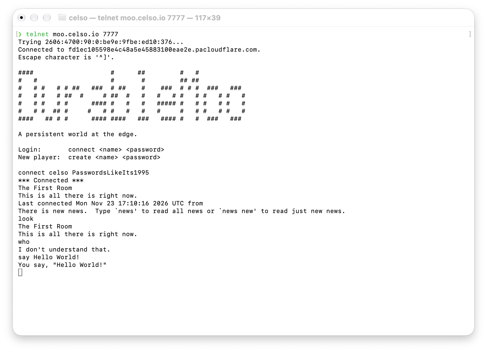

# Durable MOO

Cloudflare now supports routing [TCP traffic to a Worker](https://developers.cloudflare.com/spectrum/how-to/route-tcp-traffic-to-a-worker/) with [Spectrum](https://developers.cloudflare.com/spectrum/), so of course we had to port an old-school [virtual reality universe](https://en.wikipedia.org/wiki/MOO) to Workers.

Durable MOO is [LambdaMOO](https://developers.cloudflare.com/workers/runtime-apis/handlers/connect/) running as WebAssembly in a SQLite-backed Cloudflare Durable Object,
with native [TCP Workers](https://developers.cloudflare.com/workers/runtime-apis/handlers/connect/)
ingress and a browser terminal. No Node networking shim, Zig proxy, or shared
proxy token is required.

- 🔌 Native [TCP Workers](https://developers.cloudflare.com/workers/runtime-apis/handlers/connect/) ingress for Telnet clients.
- 🖥️ A self-hosted [Rioterm](https://github.com/raphamorim/riotermjs) browser terminal on the Worker's HTTP page.
- 🌍 A shared multiplayer world in a Durable Object.
- 🐄 [LambdaMOO](https://developers.cloudflare.com/workers/runtime-apis/handlers/connect/) compiled to WebAssembly.
- 💾 [SQLite snapshots](https://developers.cloudflare.com/durable-objects/api/sqlite-storage-api/) persisted before command output.
- ⏰ Durable Object [alarms](https://developers.cloudflare.com/durable-objects/api/alarms/) for scheduled MOO tasks.
- 🛠️ Local development with [Wrangler](https://developers.cloudflare.com/workers/wrangler/)

## Try it live

I have deployed Durable Moo at `moo.celso.io:7777`, try it:

```bash
telnet moo.celso.io 7777
```



*You may have to `brew install telnet`, or equivalent, first, since modern distros don't bundle the command anymore*

Or go to https://moo-web.celso.io for a telnet-emulated web version if you're feeling lazy.


## Architecture


All connections route to the `default` world. The handler awaits the entire
session RPC, keeping the TCP socket alive. Each session has line framing, basic
Telnet negotiation filtering, an 8 KiB input-line limit, and a 1 MiB pending
output limit that disconnects slow clients. EOF drains queued output before
closing. Commands and scheduled tasks checkpoint before releasing output.

Browser sessions reach the same world through a same-origin `/ws` WebSocket.
The Worker's HTTP handler serves the terminal page and bundled Rioterm JS/Wasm;
browser play does not require Spectrum. The diagram above shows the native TCP
path.

## Run locally

Requires Node.js 22+, pnpm 11.5.2 (Corepack), and a TCP client such as `nc` or
`telnet`. The pinned Wrangler version includes native TCP local development.

```sh
corepack enable
pnpm install --frozen-lockfile
pnpm run dev
```

Wrangler serves HTTP on `127.0.0.1:8787` and raw TCP on port `7777`, configured by
`connect` in `wrangler.jsonc`. Open **http://127.0.0.1:8787/** to play in your
browser, or connect from another terminal:

```sh
telnet 127.0.0.1 7777
```

Log in to a fresh world with `connect wizard`; use `@quit` to disconnect.
**Set the Wizard password and configure accounts before exposing the world
publicly.** Plain telnet does not encrypt passwords or commands.

### Browser terminal

The page connects automatically with a cosmetic telnet-style startup transcript
using `localhost`. The real connection is a same-origin WebSocket, not
a browser TCP connection or a DNS lookup of the displayed telnet destination.
Click inside the terminal and type directly at the cursor, just like the CLI.
Press Enter to send a line. Arrow keys, Home/End, Backspace/Delete, Ctrl+U/K/W,
Ctrl+C, and Ctrl+L provide local editing and screen control. Paste and IME input
work in the terminal, and tapping it brings up a mobile keyboard. Multiline paste
submits complete lines, like a CLI; review pasted commands before using them.

Login/password arguments are masked in the local echo and excluded from history.
Alt+P toggles private input for other sensitive answers. Ordinary command history
is held only in memory (up to 100 lines), recalled with Up/Down, and cleared on
disconnect. Nothing is saved to browser storage. The MOO still controls its own
output, so do not intentionally print credentials.

Ctrl+] opens a local `telnet>` prompt: `status` shows the connection, `quit` or
`close` disconnects, and an empty Enter returns to the world. These commands are
handled in the browser, not sent to MOO.

Scroll the terminal using the mouse wheel or focus its output and use Page Up /
Page Down. The terminal resizes with the page. Use **Disconnect** or `@quit` to
leave; **Reconnect** opens a fresh session and requires logging in again.

Rioterm uses its DOM renderer for selectable text. Remote output cannot open
links or write to the clipboard through terminal escape sequences. Output is
bounded to 1 MiB of unacknowledged bytes per WebSocket; the browser acknowledges
bytes after handing them to Rioterm. Oversized frames and invalid acknowledgements
close the session. WebSockets use the standard, non-hibernating API because the
live Wasm heap and player sessions are in memory. Use HTTPS/WSS in production;
plain HTTP development connections are not encrypted. `/healthz` remains a
plain-text health endpoint.

Local world data persists in `.wrangler/state`. Deployments do not overwrite
existing worlds. The bundled canonical `LambdaCore-17May04.db` initializes only
worlds without a saved snapshot. Its provenance and checksum are in
`lambdamoo/LambdaCore-17May04.txt` and `.db.sha256`.

## Build and check

The prebuilt Wasm module and seed database are included. Rebuilding the Wasm
requires Docker (Emscripten 4.0.15):

```sh
pnpm run build:wasm
pnpm run build:web
pnpm run types
pnpm run check
pnpm run check:worker
```

Wrangler automatically builds the browser assets on dev/deploy and rebuilds
them when files in `web/` change. No browser framework or external CDN is needed.

`check` runs Worker/browser TypeScript, Telnet/session/HTTP tests, and Wasm ABI, login, checkpoint,
restore, and cooperative-timeout checks. With local development running:

```sh
pnpm run check:tcp
```

The TCP smoke test covers login, command output, two concurrent players,
oversized input, half-close, and `@quit`. It creates a temporary player and a
Wizard property to check state across reconnects, then removes them on success:
run it only against a disposable development world.

For real browser integration tests:

```sh
pnpm exec playwright install chromium
pnpm run check:browser
```

These start an isolated local Worker on HTTP `8797` and TCP `17777`, with a
separate world in `.wrangler/browser-tests`. They cover browser login, private
input, desktop/mobile layout, reconnect, request validation, input limits, and
bidirectional browser-to-TCP chat. The test server does not use port `7777` or
the regular local world's storage.

## Deploy and expose TCP

```sh
pnpm exec wrangler login
pnpm run deploy
```

The deploy script rebuilds Wasm, checks the project, and deploys `durable-moo`
along with the bundled terminal assets. Open the deployed Worker's HTTPS URL to
play in a browser.
Only the `GameWorld` Durable Object is needed. Logs and traces are enabled.

The Worker URL is HTTP-only: connecting to `workers.dev:7777` or sending HTTP
`CONNECT` does **not** invoke the TCP handler. For public TCP:

1. Use a Cloudflare-authoritative Pro/Business zone, or a zone with Spectrum
   Enterprise, in the same account as the Worker.
2. Create a Spectrum application with **Workers (tcp)** (or **TCP → Worker**
   for Spectrum Enterprise) and select the deployed `durable-moo` Worker.
3. Choose a hostname (for example, `moo.example.com`) and edge port `7777`.
4. Connect with `telnet moo.example.com 7777`.

See [Route TCP traffic to a Worker](https://developers.cloudflare.com/spectrum/how-to/route-tcp-traffic-to-a-worker/)
for plan limits, pricing, and setup. The local `connect` config does not create a
Spectrum application. Without Spectrum Enterprise TLS termination, this server
is plaintext; inbound `startTls()` is unsupported. Another Worker can also
forward TCP through a service binding.

## Runtime and scope

- `src/index.ts`: TCP ingress, world runtime, alarms, SQLite snapshots.
- `src/tcp-session.ts`: bounded stream output and session cleanup.
- `src/websocket-session.ts`: browser transport, output acknowledgements, cleanup.
- `src/http.ts`: WebSocket request validation and browser security headers.
- `src/telnet.ts`: streaming Telnet filtering and command framing.
- `web/`: Rioterm terminal page, client, styling, and third-party license.
- `lambdamoo/`: LambdaMOO C source pinned upstream to
  `dc11b0fe6104019176c3f3ac1ef181bc664b7d2f`, Wasm adapters, seed, and Wasm binary.
- `scripts/`: reproducible Wasm build and smoke checks.

The port uses the legacy 32-bit integer/byte-quota model (`i32,bq32`). Objects,
verbs, properties, inheritance, parser/compiler, VM, connections, and scheduled
tasks remain in LambdaMOO. Native POSIX networking, outbound MOO connections,
processes, signals, XML, waifs, and filesystem checkpoint rotation are disabled
or replaced by Worker-hosted equivalents. Active TCP and browser sessions do not hibernate;
restarts/deployments may disconnect players, who can reconnect to the persisted
world. Full-world snapshots after each mutation favor correctness over
throughput. This remains a prototype, not a hardened public service.
