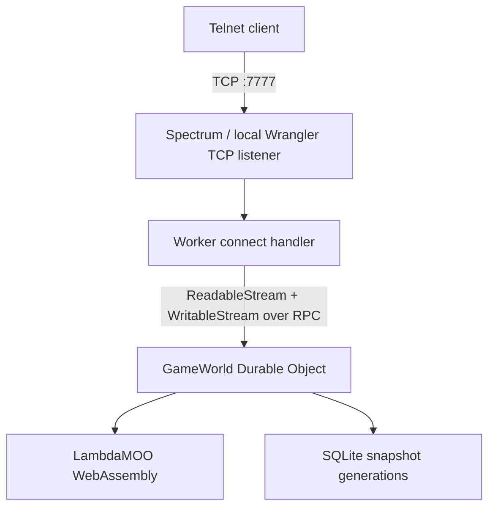

# Durable MOO

LambdaMOO running as WebAssembly in a SQLite-backed Cloudflare Durable Object,
with native [TCP Workers](https://developers.cloudflare.com/workers/runtime-apis/handlers/connect/)
ingress. No Node networking shim, Zig proxy, WebSocket tunnel, or shared proxy
token is required.

Ported from `../cloudflaremoo` at `f36820da84cc095db3c1fb21bbb6d64fecf3a572`.
The LambdaMOO C runtime, Wasm adapters, and snapshot format are preserved.

## Architecture



All connections route to the `default` world. The handler awaits the entire
session RPC, keeping the TCP socket alive. Each session has line framing, basic
Telnet negotiation filtering, an 8 KiB input-line limit, and a 1 MiB pending
output limit that disconnects slow clients. EOF drains queued output before
closing. Commands and scheduled tasks checkpoint before releasing output.

## Run locally

Requires Node.js 22+, pnpm 11.5.2 (Corepack), and a TCP client such as `nc` or
`telnet`. The pinned Wrangler version includes native TCP local development.

```sh
corepack enable
pnpm install --frozen-lockfile
pnpm run dev
```

Wrangler serves HTTP on `127.0.0.1:8787` and raw TCP on port `7777`, configured by
`connect` in `wrangler.jsonc`. In another terminal:

```sh
telnet 127.0.0.1 7777
```

Log in to a fresh world with `connect wizard`; use `@quit` to disconnect.
**Set the Wizard password and configure accounts before exposing the world
publicly.** Plain telnet does not encrypt passwords or commands.

Local world data persists in `.wrangler/state`. Deployments do not overwrite
existing worlds. The bundled canonical `LambdaCore-17May04.db` initializes only
worlds without a saved snapshot. Its provenance and checksum are in
`lambdamoo/LambdaCore-17May04.txt` and `.db.sha256`.

## Build and check

The prebuilt Wasm module and seed database are included. Rebuilding the Wasm
requires Docker (Emscripten 4.0.15):

```sh
pnpm run build:wasm
pnpm run types
pnpm run check
pnpm run check:worker
```

`check` runs TypeScript, Telnet/session tests, and Wasm ABI, login, checkpoint,
restore, and cooperative-timeout checks. With local development running:

```sh
pnpm run check:tcp
```

The TCP smoke test covers login, command output, two concurrent players,
oversized input, half-close, and `@quit`. It creates a temporary player and a
Wizard property to check state across reconnects, then removes them on success:
run it only against a disposable development world.

## Deploy and expose TCP

```sh
pnpm exec wrangler login
pnpm run deploy
```

The deploy script rebuilds Wasm, checks the project, and deploys `durable-moo`.
Only the `GameWorld` Durable Object is needed. Logs and traces are enabled.

The Worker URL is HTTP-only: connecting to `workers.dev:7777` or sending HTTP
`CONNECT` does **not** invoke the TCP handler. For public TCP:

1. Use a Cloudflare-authoritative Pro/Business zone, or a zone with Spectrum
   Enterprise, in the same account as the Worker. Free zones are unsupported.
2. Create a Spectrum application with **Workers (tcp)** (or **TCP → Worker**
   for Spectrum Enterprise) and select the deployed `durable-moo` Worker.
3. Choose a hostname (for example, `moo.example.com`) and edge port `7777`.
4. Connect with `telnet moo.example.com 7777`.

See [Route TCP traffic to a Worker](https://developers.cloudflare.com/spectrum/how-to/route-tcp-traffic-to-a-worker/)
for plan limits, pricing, and setup. The local `connect` config does not create a
Spectrum application. Without Spectrum Enterprise TLS termination, this server
is plaintext; inbound `startTls()` is unsupported. Another Worker can also
forward TCP through a service binding.

## Runtime and scope

- `src/index.ts`: TCP ingress, world runtime, alarms, SQLite snapshots.
- `src/tcp-session.ts`: bounded stream output and session cleanup.
- `src/telnet.ts`: streaming Telnet filtering and command framing.
- `lambdamoo/`: LambdaMOO C source pinned upstream to
  `dc11b0fe6104019176c3f3ac1ef181bc664b7d2f`, Wasm adapters, seed, and Wasm binary.
- `scripts/`: reproducible Wasm build and smoke checks.

The port uses the legacy 32-bit integer/byte-quota model (`i32,bq32`). Objects,
verbs, properties, inheritance, parser/compiler, VM, connections, and scheduled
tasks remain in LambdaMOO. Native POSIX networking, outbound MOO connections,
processes, signals, XML, waifs, and filesystem checkpoint rotation are disabled
or replaced by Worker-hosted equivalents. Active TCP sessions do not hibernate;
restarts/deployments may disconnect players, who can reconnect to the persisted
world. Full-world snapshots after each mutation favor correctness over
throughput. This remains a prototype, not a hardened public service.
